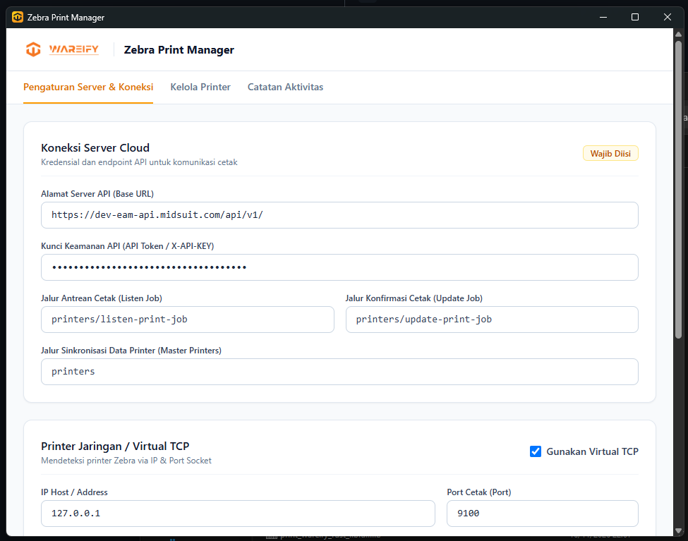

# Zebra Print Manager (Rust + Tauri + Tailwind CSS)

Aplikasi desktop native pengelola cetak barcode Zebra Printer berperforma tinggi berbasis **Rust**, **Tauri v2**, dan **Tailwind CSS**. Aplikasi ini merupakan modernisasi dari versi Java Spring Boot + Swing, dirancang ultra-ringan, responsif, dan hemat sumber daya.



---

## ⚡ Perbandingan Performa dengan Versi Java

| Parameter | Versi Java (Spring Boot + JVM) | Versi Rust (Tauri + Tailwind) | Peningkatan |
| :--- | :--- | :--- | :--- |
| **Ukuran Installer** | ~50 - 70 MB | **~2.09 MB** | **~96% lebih hemat** |
| **Konsumsi RAM (Idle)** | ~250 - 320 MB | **~15 - 30 MB** | **~90% lebih efisien** |
| **Waktu Startup** | 4 - 8 detik (JVM init) | **Instan (< 0.5 detik)** | Native C/Rust speed |
| **Deteksi Status Printer** | ~1 - 2 detik | **< 1 milidetik** | Native Windows Spooler API (`EnumPrintersW`) |
| **UI Framework** | Java Swing FlatLaf | **Tailwind CSS + Webview** | Responsif, bersih, modern |

---

## 🚀 Fitur Utama

1. **Dukungan Dual Printer Zebra**:
   - **Virtual TCP / Network Printer**: Komunikasi soket langsung ke port printer (default port `9100`).
   - **USB / Windows Spooler Printer**: Komunikasi langsung dengan driver Zebra (ZDesigner, ZT/ZD series, Generic/Text Only) via Win32 Spooler API.
2. **Deteksi Online & Offline Ultra Cepat (Native API)**:
   - Menggunakan Windows Spooler C-API (`EnumPrintersW`) tanpa bergantung pada proses PowerShell eksternal.
   - Deteksi perubahan status online/offline dan sinkronisasi ke server terjadi seketika tanpa jeda.
3. **Background Worker & Non-Blocking Polling**:
   - Polling antrean cetak (`/printers/listen-print-job`) secara asinkron menggunakan `tokio` runtime dan `reqwest`.
   - Update konfirmasi cetak otomatis dikirim kembali ke server (`/printers/update-print-job`).
4. **Windows Autostart on Boot & System Tray**:
   - Terintegrasi langsung dengan Registry Windows (`HKCU\Software\Microsoft\Windows\CurrentVersion\Run`).
   - Dapat diaktifkan / dinonaktifkan langsung melalui UI pengaturan.
   - Mendukung peluncuran senyap di latar belakang (*silent start on boot*) langsung standby di **System Tray**.
5. **Modern Dashboard & Activity Logs**:
   - Antarmuka berbasis tab yang elegan dengan Tailwind CSS.
   - Log aktivitas real-time dan shortcut langsung untuk membuka folder log aplikasi.
   - Notifikasi toast modern pengganti alert bawaan.

---

## 📦 Hasil Build & Installer

Setelah dikompilasi, file installer dan binary portabel tersedia di:
- **Installer Windows Setup EXE (NSIS)**:  
  `src-tauri/target/release/bundle/nsis/Print Wareify_1.3.0_x64-setup.exe` (~2.09 MB)
- **Installer Windows MSI**:  
  `src-tauri/target/release/bundle/msi/Print Wareify_1.3.0_x64_en-US.msi` (~3.19 MB)
- **Standalone Portable EXE**:  
  `src-tauri/target/release/print-wareify-rust.exe` (~6.3 MB)

---

## 🛠️ Panduan Pengembangan & Build

### Prasyarat
- [Node.js](https://nodejs.org/) (v18+)
- [Rust & Cargo](https://rustup.rs/) (versi stabil terbaru)
- Visual Studio C++ Build Tools (untuk Windows SDK)

### 1. Install Dependensi Frontend
```bash
npm install
```

### 2. Jalankan Mode Development
```bash
npm run tauri dev
```

### 3. Build Production (EXE & MSI)
Jalankan file `build.bat` atau gunakan perintah:
```bash
npm run build
npm run tauri build
```

---

## 📄 Lisensi
Hak cipta © 2026. Dikembangkan untuk efisiensi sistem pencetakan logistik dan pergudangan.
